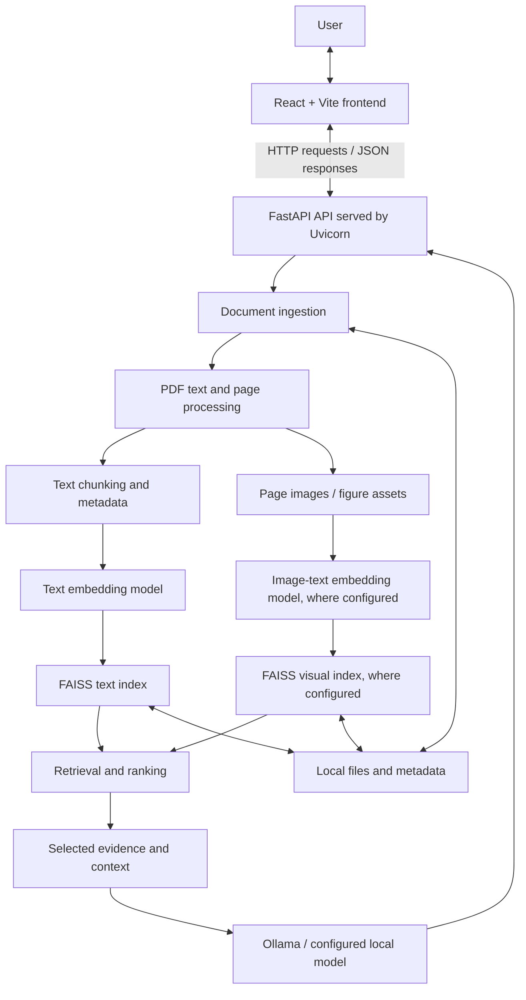

# InsightForge

InsightForge is a local research assistant with a React/Vite frontend and a FastAPI backend. It can index research documents, retrieve relevant text and visual evidence, and use a local Ollama vision model to analyze retrieved page images.

## Prerequisites

- Windows with PowerShell
- Python 3.11 recommended for backend dependency compatibility
- Node.js and npm
- Ollama installed
- Ollama model `qwen2.5vl:3b` pulled locally

> Run commands from the project root unless a different folder is specified. Keep the backend and frontend running in separate terminals. Ollama must also be running for local vision analysis.

## 1. Start Ollama

Check that Ollama is installed and the vision model is available:

```powershell
ollama --version
ollama list
```

If the model is missing:

```powershell
ollama pull qwen2.5vl:3b
```

Check the local Ollama API:

```powershell
Invoke-RestMethod http://127.0.0.1:11434/api/tags
```

If Ollama is not running, start it from a separate terminal:

```powershell
ollama serve
```

If Ollama reports that the port is already in use, it may already be running; retry the API check.

## 2. Start the backend (FastAPI)

Open a PowerShell terminal:

```powershell
cd "C:\Users\Arpit Aggarwal\Downloads\neural project 1\backend"
```

### First-time setup

Use Python 3.11 if available. Check installed Python versions:

```powershell
py -0p
```

Create a virtual environment (one-time setup):

```powershell
py -3.11 -m venv .venv
```

Activate it:

```powershell
.\.venv\Scripts\Activate.ps1
```

If PowerShell blocks activation, you can use the environment's Python executable directly instead of changing the system execution policy.

Upgrade pip and install requirements:

```powershell
python -m pip install --upgrade pip
python -m pip install -r requirements.txt
```

If you did not activate the environment, use:

```powershell
.\.venv\Scripts\python.exe -m pip install --upgrade pip
.\.venv\Scripts\python.exe -m pip install -r requirements.txt
```

### Start the API

With the environment activated:

```powershell
python -m uvicorn app.main:app --reload --host 127.0.0.1 --port 8000
```

Without activation:

```powershell
.\.venv\Scripts\python.exe -m uvicorn app.main:app --reload --host 127.0.0.1 --port 8000
```

API documentation: <http://127.0.0.1:8000/docs>

Keep this terminal open while using the application.

## 3. Start the frontend (React + Vite)

Open a **second** PowerShell terminal:

```powershell
cd "C:\Users\Arpit Aggarwal\Downloads\neural project 1\frontend"
```

Install frontend packages (first run, or after dependency changes):

```powershell
npm.cmd install
npm.cmd install react-markdown remark-gfm
```

Start the development server:

```powershell
npm.cmd run dev
```

Open the local URL printed by Vite (commonly <http://localhost:5173>).

> On Windows PowerShell, `npm` can fail because the `npm.ps1` script is blocked by the execution policy. Use `npm.cmd` as shown above; this does not require changing PowerShell's security policy.

## 4. Verify local vision support

Confirm the model is installed:

```powershell
ollama list
```

Test a simple chat request:

```powershell
Invoke-RestMethod -Method Post `
  -Uri http://127.0.0.1:11434/api/chat `
  -ContentType "application/json" `
  -Body '{"model":"qwen2.5vl:3b","messages":[{"role":"user","content":"Explain how a neural network works in two sentences."}],"stream":false}'
```

InsightForge's vision service uses these defaults:

- Ollama URL: `http://127.0.0.1:11434`
- Vision model: `qwen2.5vl:3b`
- Vision request timeout: configured in `backend/app/services/vision.py`
- Context window: check the `num_ctx` option in `backend/app/services/vision.py`

If you change the model or URL, make sure the backend configuration matches. A larger context window uses more memory. If you see a context-size error, reduce the text context sent with the images or lower the number of images processed per request.

## 5. Usual development workflow

1. Start Ollama.
2. Start the backend in its own terminal.
3. Start the frontend in another terminal.
4. Open the Vite URL in your browser.
5. Upload papers to the desired workspace and ask questions.

## Troubleshooting

### `npm.ps1 cannot be loaded because running scripts is disabled`

Use:

```powershell
npm.cmd install
npm.cmd run dev
```

### `No module named uvicorn`

Activate the backend virtual environment, then run:

```powershell
python -m pip install -r requirements.txt
```

### NumPy tries to compile and reports `NumPy requires GCC >= 8.4`

Use a supported Python version and a fresh virtual environment. Python 3.11 is recommended for this project unless the requirements have been verified against another version:

```powershell
py -3.11 -m venv .venv
.\.venv\Scripts\Activate.ps1
python -m pip install --upgrade pip
python -m pip install -r requirements.txt
```

If Python 3.11 is not installed, install it and reopen the terminal before creating the environment.

### Ollama connection refused

Check the API:

```powershell
Invoke-RestMethod http://127.0.0.1:11434/api/tags
```

If necessary, start:

```powershell
ollama serve
```

### Ollama HTTP 400: request exceeds context size

Open `backend/app/services/vision.py` and check the `options` passed to `/api/chat`. For example:

```python
"options": {
    "temperature": 0,
    "num_ctx": 8192,
    "num_predict": 1200,
},
```

Also keep the extracted text context concise. If memory is limited, use a smaller context window or fewer images.

### Backend starts but the browser cannot connect

- Confirm FastAPI is running on port `8000`.
- Open <http://127.0.0.1:8000/docs>.
- Check that the frontend API base URL points to `http://127.0.0.1:8000`.
- Read the backend terminal for the full traceback.

## Data safety

- Do not delete `backend/data`, FAISS index files, or backups to troubleshoot startup issues.
- Keep your original documents and index backups intact.
- The `.venv` directory contains installed packages and can be recreated; it is separate from your research data.
- No hosted vision API is required for the Ollama vision flow described here.

## Project structure

```text
neural project 1/
├── backend/
│   ├── .venv/
│   ├── app/
│   ├── app_backup/
│   ├── data/
│   ├── .env
│   ├── .env.example
│   ├── Dockerfile
│   ├── reindex_visuals.py
│   └── requirements.txt
├── frontend/
│   ├── dist/
│   ├── node_modules/
│   ├── src/
│   ├── index.html
│   ├── package-lock.json
│   ├── package.json
│   └── vite.config.js
├── .gitignore
├── docker-compose.yml
└── README.md

```

Adjust paths if your project is stored in a different folder.

# InsightForge

### A local, multimodal research-paper assistant

InsightForge is a research assistant designed to help users explore research papers through natural-language questions. Its architecture combines a React-based interface, a Python/FastAPI backend, document processing, semantic retrieval, vector indexing, and local AI inference through Ollama. The intended workflow supports both textual evidence and visual evidence such as figures, charts, and architecture diagrams.

> **Local-first design:** The described vision workflow uses a model served by Ollama on the same machine. This README does not require a hosted AI API key. Verify the current source code and network configuration before making a strict privacy guarantee: local inference alone does not prove that every part of an application is offline.

---

## Contents

- [1. Why InsightForge?](#1-why-insightforge)
- [2. Goals and core concepts](#2-goals-and-core-concepts)
- [3. Technology stack](#3-technology-stack)
- [4. System architecture](#4-system-architecture)
- [5. Frontend: React and Vite](#5-frontend-react-and-vite)
- [6. Backend: FastAPI and Python](#6-backend-fastapi-and-python)
- [7. Document ingestion](#7-document-ingestion)
- [8. Text chunking and embeddings](#8-text-chunking-and-embeddings)
- [9. Semantic retrieval with FAISS](#9-semantic-retrieval-with-faiss)
- [10. Visual retrieval and vision-language analysis](#10-visual-retrieval-and-vision-language-analysis)
- [11. RAG and answer generation](#11-rag-and-answer-generation)
- [12. Data flow: upload to answer](#12-data-flow-upload-to-answer)
- [13. Run locally on Windows](#13-run-locally-on-windows)
- [14. Verify the services](#14-verify-the-services)
- [15. API exploration](#15-api-exploration)
- [16. Project structure](#16-project-structure)
- [17. Configuration and model settings](#17-configuration-and-model-settings)
- [18. Troubleshooting](#18-troubleshooting)
- [19. Data safety and privacy](#19-data-safety-and-privacy)
- [20. Limitations and evaluation](#20-limitations-and-evaluation)
- [21. Suggested learning path](#21-suggested-learning-path)
- [22. Glossary](#22-glossary)

---

## 1. Why InsightForge?

Research papers are difficult to explore efficiently. A reader may need to locate a specific method, compare experimental results, understand a figure, or find the limitations described in a paper. Reading every page manually is often slow, while a generic chatbot may not have access to the paper's actual content.

InsightForge is designed to make this workflow more direct:

1. Add research papers to a local document collection.
2. Extract useful text and visual material from those documents.
3. Prepare searchable representations of the extracted content.
4. Ask questions in natural language.
5. Retrieve relevant evidence from the indexed material.
6. Use a local AI model to help explain that evidence.
7. Review the answer alongside available source information.

The objective is not simply to produce fluent text. The objective is to help a reader navigate and understand the source material.

## 2. Goals and core concepts

### Intended capabilities

- **Document question answering:** ask questions about uploaded research papers.
- **Semantic search:** find passages by meaning, not only by exact keyword matches.
- **Visual assistance:** retrieve or inspect selected figures and page images when supported by the active pipeline.
- **Local inference:** run the configured Ollama model on the local machine.
- **Reusable document index:** prepare documents once and reuse their indexed representations for later queries.
- **Source awareness:** maintain document and page metadata so retrieved content can be traced back to its source when that metadata is available.

### Important distinction

This README describes the architecture and technologies associated with the InsightForge setup. A diagram or planned feature is not proof that every behavior is implemented in every version. The exact endpoints, response fields, embedding checkpoints, ranking method, and source-citation behavior should be verified in the current source code and through the running application.

## 3. Technology stack

| Layer | Technology | Responsibility |
|---|---|---|
| User interface | React | Builds the interface from reusable components. |
| Frontend tooling | Vite | Runs the development server and builds frontend assets. |
| Frontend language | JavaScript / JSX | Handles interactions, state and rendering. |
| Answer formatting | `react-markdown`, `remark-gfm` (if present in the current frontend) | Renders Markdown headings, lists and tables. |
| Backend language | Python | Implements document processing, retrieval and orchestration. |
| API framework | FastAPI | Exposes HTTP endpoints and validates request data. |
| API server | Uvicorn | Serves the FastAPI application. |
| PDF processing | PyMuPDF | Extracts PDF text and page information and supports page/image processing. |
| Text embeddings | MiniLM through a suitable Sentence Transformers checkpoint | Converts text into semantic vectors. |
| Image-text embeddings | CLIP | Supports comparing text queries with image representations in a compatible embedding space. |
| Vector search | FAISS | Indexes and searches numerical vectors. |
| Local model runtime | Ollama | Serves local AI models through an HTTP API. |
| Vision-language model | `qwen2.5vl:3b` | Analyzes selected images with text instructions and context. |
| Local storage | Files, index files and metadata | Preserves original documents and maps search results to source material. |

**Do not confuse the roles:** MiniLM/CLIP create representations; FAISS searches those representations; Ollama runs a generation model; FastAPI connects these services; React displays the result.

## 4. System architecture

At a high level, InsightForge contains a frontend, API/backend, retrieval and processing services, local storage, and local model inference.



The diagram shows the logical design. Some implementations may combine stages, omit an optional visual index, or use a different ranking strategy. Confirm the actual pipeline before describing every branch as active.

### Two main workflows

**Ingestion workflow:**

`PDF → extraction → chunks and/or page images → embeddings → index + metadata`

Ingestion prepares a document for later search. It may take longer than a normal query because it performs extraction and embedding work.

**Question-answering workflow:**

`Question → query embeddings → retrieval → ranking → selected evidence → local model → answer`

The query workflow should reuse the existing index rather than re-embedding every document for every question.

## 5. Frontend: React and Vite

The frontend is the part the user sees in the browser. It should remain responsible for user interaction and presentation, rather than performing the entire retrieval pipeline itself.

### React

React builds the interface from components. A component might represent the chat input, a conversation message, an upload control, a document card, a loading indicator, or a source reference.

React's rendering model is state-driven: when relevant state changes, React updates the interface. For example, after an API response arrives, the frontend can store the answer in state and render it in the conversation.

Common frontend state includes:

- the current question;
- the conversation or visible result;
- selected document/workspace, if supported;
- upload progress or status;
- whether a request is loading;
- error messages returned by a failed request.

### Vite

Vite is the frontend development server and build tool. During development it serves the application and supports fast updates when source files change. For production, it builds optimized static assets. Vite does not run the Python backend or the AI model.

### JavaScript, JSX, HTML and CSS

JavaScript implements events and API calls. JSX provides an HTML-like syntax for describing React components. The browser renders the resulting interface using HTML and CSS; CSS controls layout, typography, colors, spacing and responsiveness.

### Markdown answer rendering

AI answers often contain Markdown. If the frontend uses `react-markdown` with `remark-gfm`, headings, bullet lists and tables can be rendered as formatted UI rather than displaying raw Markdown symbols. The frontend must read the response field actually returned by the backend; a mismatch between response keys can make a successful answer appear blank.

### Frontend/backend boundary

The frontend typically sends HTTP requests to FastAPI and receives JSON responses. It should not need to call Ollama directly. Keeping model calls on the backend centralizes prompt construction, local file access, retrieval and error handling.

## 6. Backend: FastAPI and Python

The backend coordinates the application's processing. It receives HTTP requests, validates inputs, calls internal services, accesses stored documents and indexes, communicates with Ollama when required, and returns structured responses.

### FastAPI

FastAPI maps URLs and HTTP methods to Python functions. It supports input validation and generates interactive API documentation. For example, an upload route can accept a file, while a query route can accept a JSON body.

### Uvicorn

Uvicorn is the ASGI server that listens for HTTP connections and serves the FastAPI application. FastAPI defines application behavior; Uvicorn runs the application server.

### Logical backend modules

Names below reflect modules discussed in this project; the exact contents should be checked in the current code.

- **Application entry point (for example, `app/main.py`):** creates the FastAPI app and registers endpoints and middleware.
- **Pipeline/orchestration (for example, `pipeline.py`):** coordinates retrieval, evidence selection and generation in the correct order.
- **Generation service (for example, `generation.py`):** builds the prompt, calls the configured text model if used, and processes its output.
- **Vision service (for example, `vision.py`):** prepares selected image inputs and calls Ollama's vision-language model.
- **Extraction/chunking services:** turn documents into text units and metadata.
- **Embedding/retrieval/vector-store services:** create query vectors, search indexes and map hits back to stored content.

This separation improves maintainability. The API route can remain relatively small while each service focuses on a specific responsibility.

### Request lifecycle

1. A request arrives at FastAPI.
2. The route validates the request and determines which operation is needed.
3. The relevant service or pipeline is called.
4. The pipeline reads files/indexes and may call local models.
5. The result is converted into the API's response format.
6. The frontend receives the response and renders it.

## 7. Document ingestion

Document ingestion converts a raw document into material that the retrieval system can search.

### PDF processing with PyMuPDF

PyMuPDF can open PDF files, iterate through pages, extract selectable text, read page metadata, and render pages or work with embedded images. The extraction quality depends on how the PDF was created.

A digitally generated PDF may expose text directly. A scanned PDF may contain only page images and therefore need OCR before its text can be searched. OCR should be described as active only if the current application invokes an OCR engine for the relevant documents.

### Text and visual assets

The ingestion stage may produce:

- extracted text;
- page numbers and document metadata;
- chunks derived from the extracted text;
- page images or figure assets;
- identifiers that connect indexed content to the original file.

Keeping source metadata is important. A vector search result is only useful to a reader if the application can recover the passage or image it represents.

### Why ingestion should be separate from querying

Ingestion can be computationally expensive. Extracting a PDF and generating embeddings should generally happen when a document is added or reprocessed. Querying should reuse the prepared indexes wherever possible.

## 8. Text chunking and embeddings

### Text chunking

A research paper can contain thousands of words. Chunking divides extracted text into smaller units that can be embedded and retrieved independently.

- **Small chunks** can be precise but may omit context needed to understand a statement.
- **Large chunks** preserve more context but can contain unrelated information and consume more model context.
- **Overlap** repeats a small portion of adjacent chunks to reduce the chance of losing meaning at chunk boundaries.

Chunk size and overlap should be chosen based on the document type and retrieval tests. Preserve document and page metadata during chunking whenever possible.

### Embeddings

An embedding is a numerical vector representing text or an image in a learned feature space. Semantic retrieval compares query and content vectors to find likely matches.

### MiniLM / Sentence Transformers

A suitable sentence-embedding checkpoint can convert text chunks into vectors. The query must be embedded using the same compatible model and preprocessing used to build the text index. Changing the model or vector dimension normally requires rebuilding the corresponding index.

### CLIP

CLIP has image and text encoders designed to produce compatible representations. In a visual retrieval path, the system can embed images and compare them with the embedding of a text query. CLIP is not OCR and does not guarantee exact recognition of small labels, equations, or numbers inside a figure.

## 9. Semantic retrieval with FAISS

FAISS is a vector search library. It is often called a vector database informally, but it does not replace the application's need to manage original files, metadata and identifiers.

A typical text retrieval process is:

1. Embed the user's question.
2. Search the FAISS index for nearby vectors using the configured index and metric.
3. Receive vector IDs and similarity/distance values.
4. Map IDs to chunk text and metadata.
5. Filter, rank or rerank candidates.
6. Pass selected evidence to the generation stage.

Cosine similarity is one common similarity measure:

`cosine(A, B) = dot(A, B) / (norm(A) * norm(B))`

The exact metric depends on index configuration and whether vectors are normalized. A larger similarity value generally indicates more aligned vectors when cosine similarity is used; it should not be confused with a calibrated probability of correctness.

### Text and visual indexes

Text vectors and CLIP image vectors generally belong to different embedding spaces and should be searched with their matching encoders/indexes. The application can then combine or compare their result lists using an explicit fusion or ranking method.

### Metadata mapping

FAISS returns vector identifiers, not a complete human-readable citation by itself. The application needs a reliable mapping such as:

`vector ID → chunk/image ID → document metadata → page/source file`

Without that mapping, source references can be incomplete or incorrect.

## 10. Visual retrieval and vision-language analysis

The visual pipeline has two distinct jobs: finding useful images and interpreting them.

### Image retrieval with CLIP

If image embeddings are indexed, a text query can be encoded with CLIP's text encoder and compared with the image vectors. The visual index returns candidate figures or page images that may match the query.

### Image interpretation with Qwen2.5-VL

The described setup uses Ollama with `qwen2.5vl:3b`. The backend can send a selected image, a textual instruction and relevant context to the local vision-language model. The model returns a textual interpretation.

### Why both are useful

- **CLIP answers:** which images may be relevant to this query?
- **FAISS answers:** which indexed vectors are nearest under the chosen search configuration?
- **Qwen2.5-VL answers:** what does the selected image appear to show?
- **Ollama provides:** the local model runtime and HTTP API.

Sending every image to the vision model is inefficient and can exceed context or memory limits. Retrieving a small number of relevant images first helps control cost and latency. Vision outputs should still be checked against the original figure, especially for small text, complex plots and numerical details.

## 11. RAG and answer generation

RAG means **Retrieval-Augmented Generation**. It combines document retrieval with an AI generator.

Instead of asking the model to answer from general model knowledge alone, the application retrieves passages and possibly visual evidence from the user's documents and includes them in the model input.

Conceptually:

`Answer = Generator(question, selected evidence)`

A strong prompt should encourage the model to:

- answer using the supplied evidence;
- distinguish explicit statements from inference;
- acknowledge when the evidence is insufficient;
- avoid inventing page numbers or citations;
- provide a clear, structured explanation.

RAG reduces the need to send an entire paper to the model, but it does not guarantee correctness. Incorrect retrieval, extraction errors, ambiguous evidence and model mistakes can still produce inaccurate answers.

### Ranking, fusion and reranking

The system may rank candidates by relevance and may combine results from text and visual search. Reciprocal Rank Fusion (RRF) is one possible way to combine multiple ranked lists, but it should only be documented as implemented if the current code actually uses it. Reranking is a separate second-stage step that reorders candidates based on an additional relevance assessment.

## 12. Data flow: upload to answer

### A. Upload flow

1. The user chooses a PDF in the React interface.
2. The frontend sends the file to the backend.
3. FastAPI validates the upload and passes it to the ingestion service.
4. PDF text and relevant page/image content are extracted.
5. Text is chunked and metadata is attached.
6. Embeddings are generated using the configured model(s).
7. FAISS indexes and local metadata are saved or updated.
8. The backend returns an upload or processing result.

### B. Question-answering flow

1. The user types a question.
2. React sends the query to FastAPI.
3. The backend embeds the query with the appropriate encoder(s).
4. Text and/or visual indexes return relevant candidates.
5. The application maps candidates to source content and ranks/selects evidence.
6. If a figure needs interpretation, selected images may be sent to Qwen2.5-VL via Ollama.
7. The generation pipeline prepares a context-grounded model request.
8. The local model generates a response.
9. FastAPI returns the answer and available source metadata.
10. React renders the response, including Markdown if supported.

## 13. Run locally on Windows

The following commands use the previously discussed project location. If the folder is elsewhere, replace the path accordingly.

**Project directory:** `C:\Users\Arpit Aggarwal\Downloads\neural project 1`

You will normally use three terminals. Keep the backend and frontend terminals open while using the app.

### Terminal 1 — Check Ollama

```powershell
ollama --version
ollama list
```

Confirm that `qwen2.5vl:3b` is listed. If it is missing, download it once:

```powershell
ollama pull qwen2.5vl:3b
```

Check the local API:

```powershell
Invoke-RestMethod http://127.0.0.1:11434/api/tags
```

If Ollama is not running, start it:

```powershell
ollama serve
```

If you see `bind: Only one usage of each socket address...`, Ollama is probably already running on port `11434`. Do not repeatedly launch another server; first check `/api/tags` or run `ollama list`.

### Terminal 2 — Start the backend

```powershell
cd "C:\Users\Arpit Aggarwal\Downloads\neural project 1\backend"
```

If the project's virtual environment already exists, activate it:

```powershell
.\.venv\Scripts\Activate.ps1
```

For a first-time setup, Python 3.11 is recommended unless the current requirements have been tested on another Python version:

```powershell
py -0p
py -3.11 -m venv .venv
.\.venv\Scripts\Activate.ps1
python -m pip install --upgrade pip
python -m pip install -r requirements.txt
```

Start FastAPI:

```powershell
python -m uvicorn app.main:app --reload --host 127.0.0.1 --port 8000
```

Backend API docs: <http://127.0.0.1:8000/docs>

If activation is blocked by PowerShell policy, you can invoke the environment's interpreter directly instead of changing the machine-wide policy:

```powershell
.\.venv\Scripts\python.exe -m uvicorn app.main:app --reload --host 127.0.0.1 --port 8000
```

### Terminal 3 — Start the frontend

```powershell
cd "C:\Users\Arpit Aggarwal\Downloads\neural project 1\frontend"
```

Install dependencies if this is the first run or dependencies changed:

```powershell
npm.cmd install
```

If the frontend uses Markdown rendering and those packages are not already installed:

```powershell
npm.cmd install react-markdown remark-gfm
```

Start Vite:

```powershell
npm.cmd run dev
```

Open the local URL printed by Vite, normally <http://localhost:5173>.

> On Windows PowerShell, `npm` may resolve to `npm.ps1` and be blocked by the execution policy. Using `npm.cmd` avoids needing to change that policy.

## 14. Verify the services

| Component | Verification | Expected result |
|---|---|---|
| Ollama | `ollama list` | Installed models are listed. |
| Ollama API | `http://127.0.0.1:11434/api/tags` | JSON response listing available models. |
| Backend | `http://127.0.0.1:8000/docs` | FastAPI interactive documentation loads. |
| Frontend | `http://localhost:5173` | InsightForge UI loads. |

A running frontend does not prove that the backend is reachable. A running backend does not prove that the vision model can process an image. Test each service separately, then test the full upload-and-query workflow.

## 15. API exploration

Use FastAPI's interactive docs at <http://127.0.0.1:8000/docs> to inspect the actual routes, HTTP methods, request schemas, and response models defined by the running version.

The architecture may include operations for:

- uploading documents;
- asking a question;
- searching indexed evidence;
- listing or managing the document library;
- checking application health.

**Do not assume endpoint names or request JSON from a diagram.** The route names and payload examples in the current `/docs` page and source code are authoritative. Test using the schemas shown there.

## 16. Project structure

The main working directory discussed for this project is:

```text
neural project 1/
├── backend/
│   ├── app/
│   │   ├── main.py                 # FastAPI application and routes
│   │   └── services/               # Processing, retrieval and model services
│   │       ├── pipeline.py         # Workflow orchestration, if present
│   │       ├── generation.py       # Text generation, if present
│   │       └── vision.py           # Local vision-model requests, if present
│   ├── data/                       # Local documents, indexes and metadata
│   ├── requirements.txt            # Python dependencies
│   └── .venv/                      # Local virtual environment (generated)
├── frontend/
│   ├── src/                        # React components and app logic
│   ├── package.json                # Frontend dependencies and scripts
│   └── vite.config.js              # Vite configuration, if present
└── README.md
```

This is a conceptual layout, not a guaranteed complete file listing. Use the actual repository tree as the source of truth. Keep legacy indexes, original PDFs, and backups intact while investigating issues.

## 17. Configuration and model settings

### Ollama settings

- Local API base URL: `http://127.0.0.1:11434`
- Vision model discussed for this project: `qwen2.5vl:3b`
- Model availability: check with `ollama list`.
- Request timeout, context window and generation limit: check the active options in the vision service and any text-generation service.

### Context size and image count

Vision requests can contain both text and image content. A request that is too large can exceed the model's configured context window. If a context error occurs:

1. Reduce the amount of text passed alongside the images.
2. Send fewer, more relevant images.
3. Review the model's context-window option and increase it only if supported and memory permits.
4. Keep a sensible output-token limit so generation does not consume all available resources.

A larger context window can increase memory use. Do not assume that changing `num_ctx` alone fixes every context or memory error.

### Frontend API URL

Ensure the frontend calls the backend address actually in use, usually `http://127.0.0.1:8000`. If the project uses a Vite environment variable for the API base URL, check the current configuration before adding or changing one.

## 18. Troubleshooting

### `ollama serve` says port 11434 is already in use

This usually means an Ollama process is already listening on that port. Run:

```powershell
ollama list
Invoke-RestMethod http://127.0.0.1:11434/api/tags
```

If those commands work, keep the existing Ollama process and continue to the backend terminal.

### `npm.ps1 cannot be loaded because running scripts is disabled`

Use the Windows command wrapper:

```powershell
npm.cmd install
npm.cmd run dev
```

### `No module named uvicorn` or another Python package is missing

Make sure the correct virtual environment is active and install the project's requirements:

```powershell
python -m pip install -r requirements.txt
```

Use the Python interpreter from the same `.venv` used to start the backend.

### Python/NumPy installation errors

If package installation tries to compile NumPy or fails because of an incompatible Python/package combination, use a supported Python version for the project's pinned dependencies. Python 3.11 is the recommended starting point for this setup unless requirements have been verified against another version. Create a fresh environment only after confirming the intended interpreter; do not delete document data or indexes to fix a package installation problem.

### Ollama connection refused

Check that the local API responds:

```powershell
Invoke-RestMethod http://127.0.0.1:11434/api/tags
```

If the model service is not running, start `ollama serve`. If the endpoint responds but the application fails, inspect the backend's URL, model name, request format and terminal traceback.

### Ollama reports that the request exceeds context size

Reduce the text context and number of images supplied to the vision model. Review the options in the active vision-service code. A larger context window may help if the model supports it and adequate memory is available, but it can increase resource usage.

### Frontend loads but questions fail

- Confirm the backend terminal shows no startup exception.
- Open <http://127.0.0.1:8000/docs>.
- Confirm the frontend's API base URL and request schema match the backend.
- Inspect the browser console and backend terminal for errors.
- Verify Ollama separately if the failing request uses a local model.

### Answers show raw Markdown markers

If the backend returns Markdown, verify that the frontend renders the correct response field through a Markdown renderer. Check that the required packages are installed and that the component receives a string rather than an unrelated object.

### Retrieval returns irrelevant passages

Check text extraction, chunk size/overlap, embedding-model consistency, vector-index loading, metadata mapping and top-k selection. Test a small set of questions with known relevant passages before changing the model.

## 19. Data safety and privacy

- **Protect original documents.** Do not delete `backend/data`, FAISS indexes, workspace metadata or backups as a first troubleshooting step.
- **Separate code from data.** Recreating a Python virtual environment is different from rebuilding or deleting the research index.
- **Keep credentials out of source control.** Do not commit secrets, private documents, generated indexes or environment files containing credentials.
- **Validate uploads.** The backend should check allowed file types and sizes and should not trust the browser's filename or client-side checks alone.
- **Treat documents as untrusted input.** Text inside a paper can contain misleading instructions. Retrieved document content should be treated as evidence, not as instructions that override the application's system behavior.
- **Review network behavior.** Local Ollama inference can avoid sending prompts to a hosted model, but the complete application's dependencies and any external calls must be reviewed before claiming it is fully offline.
- **Avoid exposing local services publicly.** Development servers and unauthenticated API endpoints should not be exposed to the public internet without appropriate security controls.

## 20. Limitations and evaluation

A useful research assistant should be evaluated, not judged only by how fluent its answers sound.

### Known general limitations

- PDF extraction may be imperfect for scanned documents, complex layouts, tables, equations and multi-column text.
- OCR may misread mathematical symbols and small labels.
- Embedding search may miss exact identifiers or subtle distinctions.
- CLIP can retrieve visually similar but semantically incorrect figures.
- Vision-language models can misinterpret charts, small text and numerical values.
- Limited model context can require selecting only a subset of evidence.
- Incorrect metadata mapping can produce incorrect page references.
- Local inference speed depends on hardware, model size and input complexity.
- Retrieval-augmented generation does not eliminate hallucinations.

### Suggested evaluation plan

Create a small test set of real questions with manually verified supporting pages. Measure:

1. **Retrieval quality:** does the relevant passage or figure appear in the top-k results?
2. **Answer faithfulness:** are the answer's claims supported by retrieved evidence?
3. **Citation accuracy:** do page/document references point to the correct source?
4. **Visual interpretation:** does the explanation correctly describe the figure?
5. **Latency:** how long do upload, retrieval and answer generation take?
6. **Robustness:** what happens with scanned PDFs, empty files, oversized uploads, and unsupported questions?

Do not claim a numerical accuracy improvement unless it has been measured on a documented test set.

## 21. Suggested learning path

A new contributor can study the project in this order:

1. **Start the app:** run Ollama, backend and frontend; verify each URL.
2. **Read the frontend entry point:** understand how React mounts the app and how the main component manages state.
3. **Trace an API request:** find the frontend function that sends a question and identify the matching FastAPI route.
4. **Read the backend entry point:** inspect route definitions, validation and response construction.
5. **Trace document ingestion:** follow PDF extraction, chunking, embedding generation and index persistence.
6. **Study embeddings:** understand what vectors represent and why query/document encoders must match.
7. **Study FAISS retrieval:** follow vector IDs back to source chunks and metadata.
8. **Trace the vision path:** see how candidate images are selected, encoded and sent to Ollama.
9. **Trace generation:** inspect how context and instructions are constructed and how the model response is returned.
10. **Run controlled tests:** use questions with known answers and verify sources manually.

For every stage, ask: what is the input, what transformation happens, what is the output, where is it stored, and how is failure reported?

## 22. Glossary

| Term | Meaning |
|---|---|
| API | A defined interface that lets software components communicate. |
| ASGI | An interface between asynchronous Python web servers and applications. |
| Chunk | A smaller text unit created from a larger document. |
| CLIP | A model family that learns compatible image and text representations. |
| Embedding | A numerical vector representing text, an image, or other content. |
| FAISS | A library for efficient similarity search over dense vectors. |
| FastAPI | A Python framework for building HTTP APIs. |
| Hallucination | Generated content that is unsupported or incorrect. |
| Ingestion | Preparing documents and their metadata for later retrieval. |
| MiniLM | A family of compact transformer models; suitable sentence-embedding checkpoints support semantic search. |
| OCR | Optical Character Recognition, which converts text in images into machine-readable text. |
| Ollama | A local model runtime that exposes models through an API. |
| RAG | Retrieval-Augmented Generation: supplying retrieved evidence to a generator. |
| Reranking | Reordering retrieved candidates using a further relevance assessment. |
| Semantic search | Finding content by meaning represented in embeddings. |
| Vite | A frontend development server and build tool. |
| Vision-language model | A model that processes visual input together with text. |
| Vector index | A data structure used to search numerical representations efficiently. |
| Uvicorn | An ASGI server that runs the FastAPI application. |

---

## Final note for contributors

Use the current source code, dependency files, and FastAPI `/docs` page as the authority for implementation-specific details. This README explains the system's intended design and gives a practical local setup path; it should be updated whenever endpoint names, model settings, storage formats, or pipeline behavior change.


.\.venv\Scripts\python.exe -m uvicorn app.main:app --host 127.0.0.1 --port 8000

Using only evidence from the uploaded research paper, compare image-based RAG, image+text-based RAG, page-level retrieval, and element-level retrieval.

First, distinguish retrieval modality (image-only vs. image+text) from retrieval granularity (page-level vs. element-level). Explain how each approach works, its advantages, and its limitations, using only claims supported by the paper.

Include a Markdown comparison table with these exact columns: Approach, Retrieval mechanism, Advantages, Limitations, Retrieval accuracy, Computational cost, Latency, and Scalability.

For every metric, provide reported measurements only if the paper explicitly provides them. Otherwise, write "Not reported in the paper."

Cite exact printed page numbers for important claims. Do not invent numerical results, author citations, method examples, or limitations. Clearly distinguish explicit findings from reasonable inferences. If the evidence is insufficient, state what is missing. Avoid generic explanations and unrelated topics.